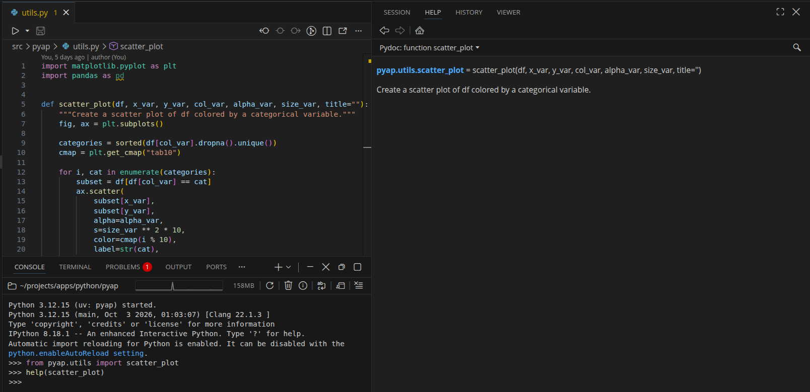
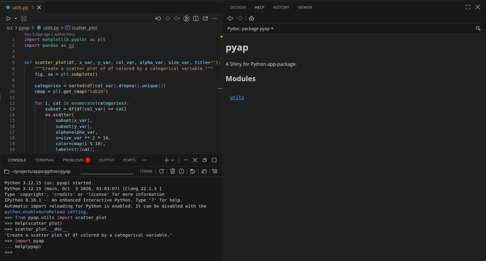
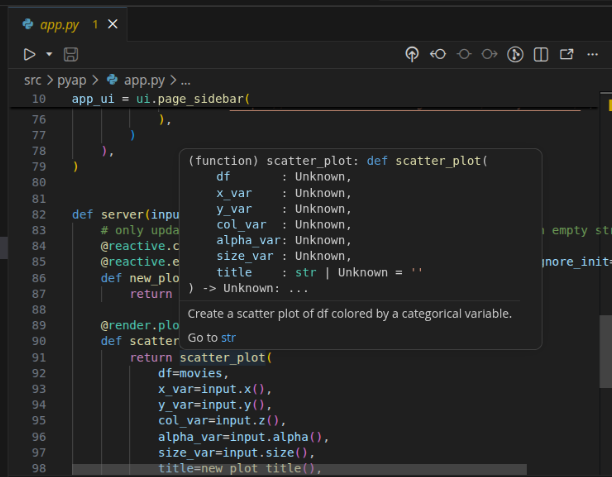

In the [Development Workflow](development.qmd) chapter, we settled into a loop of editing code in `src/pyap/`, saving, and checking the result. `pyap` installs and runs, but the only documentation was a single sentence on `scatter_plot()` and another in `__init__.py`. This means anyone opening the package (including me, six months from now) would need to read the function body to learn what each argument expects and what comes back.

This chapter fixes that by writing complete docstrings for the code in `pyap`, then rendering them into an HTML documentation site.

::: {.callout-note title="Comparison to R package documentation" collapse="true"}

If you've read the [Documentation](https://mjfrigaard.github.io/shiny-app-pkgs/document.html) chapter of [Shiny App-Packages](https://mjfrigaard.github.io/shiny-app-pkgs/), you'll know we document app-package functions with `roxygen2`:

* Help documentation is created by placing `#'` comments above each function   
* Tags like `@title` and `@description` are used to organize the documentation   
* We run `devtools::document()` to turn them into `.Rd` files in `man/`

:::

Python stores docstrings on the function itself, so `help()` can read it the moment the module is imported. I've found this shifts the work from running tools to writing well, so most of this chapter is about what goes inside the triple quotes.

## Diverging branches

Chapters 1 to 4 built `pyap` in a straight line: each branch started where the previous one ended. Going forward, some of the branches will diverge. I've done this to try and accurately demonstrate how Python package development goes. In R, documentation is limited to `roxygen2` tags (and `pkgdown` for building package websites). But as with most things in Python, there are several valid tools for the same job. 

For example, from what I've seen, there are at least two excellent ways to turn docstrings into package documentation with a website (and a third, `great-docs`, which we'll cover in a later chapter). So, in this chapter, I'd rather show a working version of each option than pretend there's only one. The branches in this chapter are here to illustrate *alternatives* (different tools for the same step). 

The diagram below shows the branches in this chapter:

```{mermaid}
%%| fig-cap: 'The main line and a side branch'
%%| fig-align: center
%%{init: {'theme': 'neutral', 'themeVariables': { 'fontFamily': 'monospace', "fontSize":"14px"}}}%%

flowchart LR
    B4["<strong>04_dev</strong><br/>edit, sync,<br/>run loop"]
    B51["<strong>05.1_pdoc</strong><br/>docstrings +<br/><code>pdoc</code>"]
    B6["<strong>06_dependencies</strong><br/>next chapter"]
    B52["<strong>05.2_mkdocs</strong><br/><code>mkdocs</code> +<br/><code>mkdocstrings</code>"]

    B4 --> B51 --> B6
    B51 -.->|"alternative"| B52

    classDef project fill:#553c9a,stroke:#b794f4,color:#fff
    classDef uvStyle fill:#744210,stroke:#f6ad55,color:#fff
    classDef pkg fill:#2d3748,stroke:#48bb78,color:#fff

    class B4 project
    class B51,B6 pkg
    class B52 uvStyle
```

`05.1_pdoc` adds the docstrings and builds the documentation with `pdoc`. `05.2_mkdocs` starts from `05.1_pdoc`, keeps the docstrings, and swaps `pdoc` for `mkdocs`. The dotted arrow marks it as a side branch: the [Dependencies](dependencies.qmd) chapter will build on `05.1_pdoc`.

Let's dive into docstrings!

## What is a docstring?

A docstring is a string literal placed as the first statement in a module, function, or class. Python doesn't discard it like a comment. It attaches the string to the object as its `__doc__` attribute, which is what makes docstrings readable from the console, the editor, and documentation tools.

::: {.callout-note title="Comparison to R package documentation" collapse="true"}

A string literal is a string value written directly in the code, between quotes (`"movies.csv"` or `'IMDB rating'`), rather than one built by an expression or stored in a variable. R has string literals too (`"movies.csv"`, and raw strings like `r"(C:\path)"` since R 4.0), but R doesn't treat a string at the top of a function body as documentation.

If we placed `"Create a scatter plot"` as the first line of an R function, R would evaluate it, discard the result, and move on. This is why R documentation lives outside the function code, in `roxygen2` comments that `document()` turns into `.Rd` files.

:::

By convention, docstrings are written inside three consecutive double quotes: `"""docstring text"""`. In the `04_dev` branch, if we open `src/pyap/utils.py`, we can see a docstring for `scatter_plot()`: 

```python
def scatter_plot(df, x_var, y_var, col_var, alpha_var, size_var, title=""):
    """Create a scatter plot of df colored by a categorical variable."""
```

A comment in the same position (`# Create a scatter plot...`) would look almost identical in the editor, but it would be invisible to everything below.

### Where Python reads docstrings

The fastest way to read a docstring is `help()` in a Python console (Positron's **Console**, or `uv run python` from the project root in a terminal). We'll import the function and pass it to `help()`:

```python
>>> from pyap.utils import scatter_plot
>>> help(scatter_plot)
```

<em>

```default
Help on function scatter_plot in module pyap.utils:

scatter_plot(df, x_var, y_var, col_var, alpha_var, size_var, title='')
    Create a scatter plot of df colored by a categorical variable.
```

</em>

The output above is from a terminal, where `help()` opens a pager (press <kbd>q</kbd> to return to the prompt). In Positron, `help()` displays the function's signature and docstring in the **Help** pane:

{width="100%" fig-align="center"}


The raw string is available on the `__doc__` attribute:

```python
>>> scatter_plot.__doc__
```

<em>

```default
'Create a scatter plot of df colored by a categorical variable.'
```

</em>

Modules and packages have docstrings too. `pyap.__doc__` returns the sentence in `src/pyap/__init__.py` from the [Python Packages](packages.qmd#moving-the-code-into-srcpyap) chapter, and `help(pyap)` shows the package docstring along with its contents. In a terminal, the contents list both `app` and `utils`, but Positron's **Help** pane only listed `utils` (the module we had already imported):

{width="100%" fig-align="center"}

Editors read docstrings as well. In Positron, hovering over `scatter_plot` in `app.py` shows its signature and docstring in a tooltip, and the same text appears in the signature help while we type the arguments.

{width="100%" fig-align="center"}

The diagram below shows the two routes a docstring takes from our source files to a reader:

```{mermaid}
%%| fig-cap: 'Where docstrings are read'
%%| fig-align: center
%%{init: {'theme': 'neutral', 'themeVariables': { 'fontFamily': 'monospace', "fontSize":"14px"}}}%%

flowchart LR
    Src(["docstrings in<br/><code>src/pyap/*.py</code>"])

    subgraph Runtime["<strong>Imported</strong>"]
        Doc("<code>__doc__</code><br/>on each object")
        Help("<code>help()</code><br/>in the console")
        Pdoc("<code>pdoc</code>")
    end

    subgraph Static["<strong>Read from source</strong>"]
        Hover("editor hover<br/>(Positron)")
        Mk("<code>mkdocstrings</code>")
    end

    Site[\"HTML<br/>documentation site"\]

    Src -->|"import"| Doc
    Doc --> Help
    Doc --> Pdoc
    Src -->|"parse"| Hover
    Src -->|"parse"| Mk
    Pdoc --> Site
    Mk --> Site

    classDef srcStyle fill:#2d3748,stroke:#48bb78,color:#fff
    classDef runStyle fill:#744210,stroke:#f6ad55,color:#fff
    classDef staticStyle fill:#553c9a,stroke:#b794f4,color:#fff
    classDef siteStyle fill:#2c5282,stroke:#63b3ed,color:#fff

    class Src srcStyle
    class Doc,Help,Pdoc runStyle
    class Hover,Mk staticStyle
    class Site siteStyle
```

Docstrings live in the source files, and they reach readers by two routes:

* The top route imports `pyap` and reads `__doc__` from the live objects. `help()` works this way, and so does `pdoc`, which we'll use to build the HTML site. 

* The bottom route parses the `.py` files *without* running them. Editors typically use a language server for hover text, and `mkdocstrings` (a plugin for `mkdocs`) reads source files by default. 

The difference matters for `pyap`, because importing `pyap.app` runs code (we'll come back to this when we build the site). Every route reads the same string. There's no generated help folder to keep in sync, so the docstring in the source file is the documentation.

## Writing docstrings

The docstrings in this section (and the `pdoc` site in the next one) are on the `05.1_pdoc` branch. Check it out to follow along, and sync the environment:

```bash
git checkout 05.1_pdoc
```

```bash
uv sync
```

The branch adds docstrings to all three modules in `src/pyap/`, adds `pdoc` to the `dev` dependency group (`pyproject.toml` and `uv.lock`), and adds `docs/` to `.gitignore`. The project structure is below:

<em>

```default
pyap/
├── .gitignore
├── .python-version
├── .vscode/
│   └── settings.json
├── README.md
├── movies.csv
├── pyproject.toml
├── src/
│   └── pyap/
│       ├── __init__.py
│       ├── app.py
│       └── utils.py
└── uv.lock
```

</em>

Unlike `roxygen2`, which generates `.Rd` files in `man/`, docstrings add no files to the package. Documentation in Python lives *inside* the files we already have, which is why the tree looks exactly like the one from the `04_dev` branch.

### PEP 257 basics

[PEP 257](https://peps.python.org/pep-0257/) sets the ground rules every docstring convention builds on. The ones we'll follow in `pyap` are:

1. Use triple double quotes (`"""`), even for one line docstrings.
2. Start with a one line summary that fits on the first line and ends with a period. PEP 257 recommends the imperative mood ("Create a scatter plot", not "Creates a scatter plot").
3. For longer docstrings, leave a blank line after the summary, then add the details. Put the closing `"""` on a line by itself.
4. Place the docstring as the first statement in the body (or at the top of the file, for a module docstring).

The existing docstring on `scatter_plot()` in `src/pyap/utils.py` already follows the first two rules. The summary line deserves extra attention, because it's the line tools show in package indexes and tooltips. PEP 257 doesn't say anything about *how* to describe arguments or return values, though. That job belongs to a docstring convention (which we'll cover below).

### Choosing a convention

A docstring convention is just an agreed set of section headings and layouts, so people and tools know where to find the parameters, the return value, and the examples.[^doc-tags] The two most common conventions in data science code are described below:

[^doc-tags]: Conventions play the role of `roxygen2` tags. `@param` becomes a `Parameters` section, `@return` becomes `Returns`, and `@examples` becomes `Examples`.

* [NumPy style](https://numpydoc.readthedocs.io/en/latest/format.html): section titles underlined with dashes, and each parameter on its own line followed by its type.
* [Google style](https://google.github.io/styleguide/pyguide.html#38-comments-and-docstrings): section titles followed by a colon (`Args:`, `Returns:`), with each parameter indented beneath.

The [Whole Game](whole_game.qmd) chapter used Google style for `geyser_waiting()`, and it's a fine choice. For the remaining branches in `pyap`, I'll switch to NumPy style because `pandas`, `numpy`, and `matplotlib` (all three of the packages `scatter_plot()` depends on) document their functions this way, so our help pages will read like the ones I consulted while writing the code. NumPy style also has more room for longer descriptions, which helps when an argument needs a sentence or two of explanation.

The convention matters less than consistency. Pick one convention for the entire package, and tell the documentation tools which one you picked (we'll do this with a flag below).

### Function docstrings

A NumPy style function docstring has a summary line, an extended description, and a series of sections. The summary line and description for `scatter_plot()` are below:

```{python}
#| eval: false 
#| code-fold: show 
#| code-summary: 'show/hide summary and description'
def scatter_plot(df, x_var, y_var, col_var, alpha_var, size_var, title=""):
    """Create a scatter plot colored by a categorical variable.

    Draws one scatter layer per category in `col_var`, so each category
    gets its own color and legend entry. Axis labels and the legend title
    are built from the column names (underscores become spaces, and each
    word is capitalized).
    """
```

The summary line plays the role of `@title`, and the extended description plays the role of `@description`.

Each section below is part of the same docstring, and maps to something a reader would otherwise have to work out from the code:

#### `Parameters` {.unnumbered}

Parameters need one entry per argument, written as `name : type` with the description indented below it. Optional arguments add `optional` after the type.

```{python}
#| eval: false 
#| code-fold: show 
#| code-summary: 'show/hide Parameters section'
def scatter_plot(df, x_var, y_var, col_var, alpha_var, size_var, title=""):
    """
    Parameters
    ----------
    df : pandas.DataFrame
        Data containing the columns named in `x_var`, `y_var`, and
        `col_var`.
    x_var : str
        Name of the numeric column mapped to the x axis.
    y_var : str
        Name of the numeric column mapped to the y axis.
    col_var : str
        Name of the categorical column used to color the points. Rows
        with a missing value in this column are not plotted.
    alpha_var : float
        Point transparency, from 0 (transparent) to 1 (opaque).
    size_var : float
        Point size. The marker area is `size_var ** 2 * 10`.
    title : str, optional
        Plot title. The default (an empty string) leaves the plot
        untitled.
    """
```

#### `Returns` {.unnumbered}

The `Returns` section should include the type of the returned object and a short description. `scatter_plot()` returns the figure rather than drawing it, which is what `@render.plot` expects.

```{python}
#| eval: false 
#| code-fold: show 
#| code-summary: 'show/hide Returns section'
def scatter_plot(df, x_var, y_var, col_var, alpha_var, size_var, title=""):
    """
    Returns
    -------
    matplotlib.figure.Figure
        The figure holding the scatter plot.
    """
```

#### `Notes` {.unnumbered}

`Notes` can be any details that don't belong to a single argument. The `tab10` limit is easy to miss until a column has more than ten categories.

```{python}
#| eval: false 
#| code-fold: show 
#| code-summary: 'show/hide Notes section'
def scatter_plot(df, x_var, y_var, col_var, alpha_var, size_var, title=""):
    """
    Notes
    -----
    Colors come from the matplotlib `tab10` colormap, which repeats
    after ten categories.
    """
```

#### `Examples` {.unnumbered}

Like `@examples` in `roxygen2`, the `Examples` section holds code a reader can paste into the console, written in the `>>>` prompt format.[^doc-doctest]

[^doc-doctest]: The `>>>` format comes from Python's [doctest](https://docs.python.org/3/library/doctest.html) module, and `pytest` can run these examples as tests with the `--doctest-modules` flag. This example reads `movies.csv` from the working directory, so it only runs from the project root (the [Data](data.qmd) chapter removes this limitation).

```{python}
#| eval: false 
#| code-fold: show 
#| code-summary: 'show/hide Examples section'
def scatter_plot(df, x_var, y_var, col_var, alpha_var, size_var, title=""):
    """
    Examples
    --------
    >>> import pandas as pd
    >>> from pyap.utils import scatter_plot
    >>> movies = pd.read_csv("movies.csv")
    >>> fig = scatter_plot(movies, "critics_score", "audience_score",
    ...                    "mpaa_rating", 0.4, 3)
    """
```

I've written the descriptions from the reader's side of the function. `col_var` doesn't just say "column for color"; it also says what happens to missing values, because that's the question someone debugging a sparse plot will have. This is the same advice I gave for `@param` in the R book: include the type and what the argument does.

The full docstring for `scatter_plot()` is below:

```{python}
#| eval: false 
#| code-fold: true 
#| code-summary: 'show/hide full scatter_plot() docstring'
# in src/pyap/utils.py
def scatter_plot(df, x_var, y_var, col_var, alpha_var, size_var, title=""):
    """Create a scatter plot colored by a categorical variable.

    Draws one scatter layer per category in `col_var`, so each category
    gets its own color and legend entry. Axis labels and the legend title
    are built from the column names (underscores become spaces, and each
    word is capitalized).

    Parameters
    ----------
    df : pandas.DataFrame
        Data containing the columns named in `x_var`, `y_var`, and
        `col_var`.
    x_var : str
        Name of the numeric column mapped to the x axis.
    y_var : str
        Name of the numeric column mapped to the y axis.
    col_var : str
        Name of the categorical column used to color the points. Rows
        with a missing value in this column are not plotted.
    alpha_var : float
        Point transparency, from 0 (transparent) to 1 (opaque).
    size_var : float
        Point size. The marker area is `size_var ** 2 * 10`.
    title : str, optional
        Plot title. The default (an empty string) leaves the plot
        untitled.

    Returns
    -------
    matplotlib.figure.Figure
        The figure holding the scatter plot.

    Notes
    -----
    Colors come from the matplotlib `tab10` colormap, which repeats
    after ten categories.

    Examples
    --------
    >>> import pandas as pd
    >>> from pyap.utils import scatter_plot
    >>> movies = pd.read_csv("movies.csv")
    >>> fig = scatter_plot(movies, "critics_score", "audience_score",
    ...                    "mpaa_rating", 0.4, 3)
    """
    # function body unchanged
```

::: {.callout-tip title="Types in docstrings and type hints" collapse="true"}

NumPy style puts each parameter's type in the docstring. Without type hints, editors can't infer the types either (the Positron tooltip above shows `Unknown` for every argument). Python also supports type hints in the function signature (`def scatter_plot(df: pd.DataFrame, x_var: str, ...)`), and many documentation tools display both. We'll keep the types in the docstring for now, so the signature in `utils.py` doesn't change in this chapter.

:::

### Module docstrings

A module docstring describes the file as a whole. It must be the first statement in the file, above the imports.

```{python}
#| eval: false
#| code-fold: show
#| code-summary: 'show/hide scatter plot module docstring'
"""Plotting utilities for the pyap movies app.

The functions in this module are plain matplotlib code with no Shiny
dependencies, so they can be called from the app, from a test, or from
the Python console.
"""

import matplotlib.pyplot as plt
import pandas as pd

```

`src/pyap/app.py` gets a module docstring too. The `# Run with:` comment can stay on the first line, because comments aren't statements; the docstring is still the first statement in the file:

```{python}
#| eval: false
#| code-fold: show
#| code-summary: 'show/hide app module docstring'
# Run with: uv run shiny run src/pyap/app.py
"""Shiny app for exploring the movies data.

Defines the UI (`app_ui`), the server function (`server()`), and the
`app` object that `shiny run` looks for. The data are read from
`movies.csv` in the working directory when this module is imported.
"""

from shiny import App, ui, render, reactive
import pandas as pd

from pyap.utils import scatter_plot
```

The last sentence is a deliberate warning. Reading `movies.csv` at import time is the behavior that will trip up `pdoc` below, and the docstring is the right place to tell readers about it until the [Data](data.qmd) chapter changes it.

#### `server` docstring

The `server()` function also gets a short docstring. Shiny passes it three objects, so the `Parameters` section names their types and lists the inputs and outputs the function uses:

```{python}
#| eval: false
#| code-fold: show
#| code-summary: 'show/hide server docstring'
def server(input, output, session):
    """Server logic for the movies app.

    Parameters
    ----------
    input : shiny.Inputs
        Input values from the sidebar (`x`, `y`, `z`, `alpha`, `size`,
        `plot_title`, and `update_plot_title`).
    output : shiny.Outputs
        Outputs rendered by the app (`scatterplot`).
    session : shiny.Session
        The current user session.
    """
```

The rest of `app.py` is unchanged. The functions defined inside `server()` (`new_plot_title()` and `scatterplot()`) are created each time a session starts, so documentation tools don't see them; the existing comment above `new_plot_title()` is the right level of documentation for them.

### The package docstring

The docstring in `src/pyap/__init__.py` is the first thing a reader sees in `help(pyap)` and on the front page of a documentation site. We'll keep the summary line from the [Python Packages](packages.qmd) chapter and add a short description that points to the modules:

```python
"""A Shiny for Python app-package.

`pyap` packages the movies review app as an installable Python package.
The app (UI, server, and the `app` object) lives in `pyap.app`, and the
plotting code it calls lives in `pyap.utils`.
"""
```

A package docstring is a good place for orientation, not detail. The function level docstrings carry the specifics, and the package docstring tells the reader where to look for them.[^doc-pkg-rd]

[^doc-pkg-rd]: The package docstring is the Python counterpart of the package level help page (`?sap`) that `usethis::use_package_doc()` creates with the `"_PACKAGE"` sentinel.

### Confirming the docstrings

Docstrings are part of the source code, so the editable install picks them up without a sync (this is the No action path from the [Development Workflow](development.qmd#the-edit-run-check-loop) chapter). A console that already imported `pyap.utils` still holds the old function, though, so we'll restart it (or start a new one with `uv run python`) and call `help()` again:

```python
>>> from pyap.utils import scatter_plot
>>> help(scatter_plot)
```

<em>

```default
Help on function scatter_plot in module pyap.utils:

scatter_plot(df, x_var, y_var, col_var, alpha_var, size_var, title='')
    Create a scatter plot colored by a categorical variable.

    Draws one scatter layer per category in `col_var`, so each category
    gets its own color and legend entry. Axis labels and the legend title
    are built from the column names (underscores become spaces, and each
    word is capitalized).

    Parameters
    ----------
    df : pandas.DataFrame
        Data containing the columns named in `x_var`, `y_var`, and
        `col_var`.
    x_var : str
        Name of the numeric column mapped to the x axis.
    y_var : str
        Name of the numeric column mapped to the y axis.
    col_var : str
        Name of the categorical column used to color the points. Rows
        with a missing value in this column are not plotted.
    alpha_var : float
        Point transparency, from 0 (transparent) to 1 (opaque).
    size_var : float
        Point size. The marker area is `size_var ** 2 * 10`.
    title : str, optional
        Plot title. The default (an empty string) leaves the plot
        untitled.

    Returns
    -------
    matplotlib.figure.Figure
        The figure holding the scatter plot.

    Notes
    -----
    Colors come from the matplotlib `tab10` colormap, which repeats
    after ten categories.

    Examples
    --------
    >>> import pandas as pd
    >>> from pyap.utils import scatter_plot
    >>> movies = pd.read_csv("movies.csv")
    >>> fig = scatter_plot(movies, "critics_score", "audience_score",
    ...                    "mpaa_rating", 0.4, 3)
```

</em>

The output should show the full NumPy style docstring below the signature. `help()` prints the sections as plain text; the underlined headings are what documentation tools look for when they turn the docstring into HTML.

## Rendering documentation to HTML

`help()` and editor tooltips cover anyone who already has `pyap` installed. A documentation site covers everyone else (and makes the docstrings searchable). We'll use [`pdoc`](https://pdoc.dev/) on the `05.1_pdoc` branch, build the same site with `mkdocs` on the `05.2_mkdocs` branch, and finish with a short look at `great-docs`.

### Adding `pdoc`

`pdoc` generates API documentation from a package's docstrings with no configuration file. We only need it while developing `pyap`, so we'll add it to the `dev` dependency group with `--dev`:

```bash
uv add --dev pdoc
```

<em>

```default
Resolved 50 packages in 310ms
   Building pyap @ file:///path/to/pyap
      Built pyap @ file:///path/to/pyap
Prepared 5 packages in 169ms
Uninstalled 1 package in 1ms
Installed 6 packages in 12ms
 + jinja2==3.1.6
 + markdown2==2.5.5
 + markupsafe==3.0.4
 + pdoc==16.0.0
 ~ pyap==0.1.0 (from file:///path/to/pyap)
 + pygments==2.21.0
```

</em>

`uv add` updates `pyproject.toml`, `uv.lock`, and `.venv/` in one step. The new table in `pyproject.toml` is below:

```toml
[dependency-groups]
dev = [
    "pdoc>=16.0.0",
]
```

Installing `pyap` never installs `pdoc`, because dependency groups aren't part of the package metadata (we covered this in the [Python Packages](packages.qmd#dependency-groups) chapter).

### Previewing the site

`pdoc` takes the name of the package to document. With `uv run`, we're sure it imports the editable install of `pyap` from `.venv/`:

```bash
uv run pdoc --docformat numpy pyap
```

<em>

```default
pdoc server ready at http://localhost:8080
```

</em>

This starts a local web server and opens the documentation in the browser. The `--docformat numpy` flag tells `pdoc` to read the `Parameters`, `Returns`, `Notes`, and `Examples` sections as NumPy style (without it, the underlined headings render as plain text). The package docstring becomes the landing page, and `pyap.app` and `pyap.utils` each get their own page. Press <kbd>Ctrl</kbd> + <kbd>C</kbd> in the terminal to stop the server.

<!-- TODO: screenshot of the pdoc page for pyap.utils (images/document-pdoc-utils.png) -->

`pdoc` only documents public names. Anything that starts with an underscore is skipped, and if a module defines `__all__`, only the names it lists are included.[^doc-export]

[^doc-export]: This is the closest `pdoc` comes to `@export`. In R, unexported functions still get help pages unless they're marked `@noRd`; in Python, a leading underscore keeps a function out of the generated site.

::: {.callout-warning title="pdoc imports pyap"}

`pdoc` builds its pages from the imported package (the top route in the diagram above), and importing `pyap.app` runs `pd.read_csv("movies.csv")`. The relative path is resolved from the folder we run `pdoc` in, so `pdoc` has to be run from the project root, exactly like the app. From any other folder, the import of `pyap.app` fails with a `FileNotFoundError`. The [Data](data.qmd) chapter removes this dependence on the working directory.

:::

### Writing a static site

To write the site to files instead of serving it, we pass an output folder with `-o`:

```bash
uv run pdoc --docformat numpy -o docs pyap
```

`pdoc` writes one HTML page per module, plus an index page and a search index. The `docs/` folder should look like this:

<em>
```default
docs/
├── index.html
├── pyap/
│   ├── app.html
│   └── utils.html
├── pyap.html
└── search.js
```
</em>

The pages are self contained, so opening `docs/index.html` in a browser shows the same site as the preview. The `05.1_pdoc` branch lists `docs/` in `.gitignore`, because the HTML can always be rebuilt from the docstrings. We'll publish it in the [Deploy](deploy.qmd) section.

## Building the site with `mkdocs`

`pdoc` is the simplest way to get from docstrings to HTML, but every page it builds comes from a docstring. When a package needs written guides alongside its reference pages, [`mkdocs`](https://www.mkdocs.org/) is a common next step. `mkdocs` builds a site from a folder of Markdown files, and the [`mkdocstrings`](https://mkdocstrings.github.io/) plugin inserts API documentation from docstrings into those pages.

The two tools can't share a project as it's set up on `05.1_pdoc`, because they use `docs/` for opposite jobs. `pdoc -o docs` writes generated HTML into `docs/`, which is why that branch ignores the folder. `mkdocs` reads its Markdown sources from `docs/`, so the folder has to be committed. Rather than pointing one tool at a different folder, the `05.2_mkdocs` branch swaps `pdoc` out entirely. Check it out to follow along:

```bash
git checkout 05.2_mkdocs
uv sync
```

This is the side branch from the diagram at the top of the chapter. It keeps every docstring from `05.1_pdoc`, and the main line of the book doesn't continue from it.

### Swapping the dev dependencies

`uv remove --dev` takes `pdoc` out of the `dev` group, and `uv add --dev` adds `mkdocs` and `mkdocstrings` (the `[python]` extra installs the Python handler for `mkdocstrings`):

```bash
uv remove --dev pdoc
```

<em>

```default
Resolved 45 packages in 13ms
   Building pyap @ file:///path/to/pyap
      Built pyap @ file:///path/to/pyap
Prepared 1 package in 3ms
Uninstalled 6 packages in 4ms
Installed 1 package in 0.55ms
 - jinja2==3.1.6
 - markdown2==2.5.5
 - markupsafe==3.0.4
 - pdoc==16.0.0
 ~ pyap==0.1.0 (from file:///path/to/pyap)
 - pygments==2.21.0
```

</em>

```bash
uv add --dev mkdocs "mkdocstrings[python]"
```

<em>

```default
Resolved 62 packages in 321ms
   Building pyap @ file:///path/to/pyap
      Built pyap @ file:///path/to/pyap
Downloading mkdocs (3.7MiB)
 Downloaded mkdocs
Prepared 15 packages in 1.13s
Uninstalled 1 package in 0.67ms
Installed 17 packages in 5ms
 + ghp-import==2.1.0
 + griffelib==2.3.2
 + jinja2==3.1.6
 + markdown==3.11
 + markupsafe==3.0.4
 + mergedeep==1.3.4
 + mkdocs==1.6.1
 + mkdocs-autorefs==1.4.4
 + mkdocs-get-deps==0.2.2
 + mkdocstrings==1.0.7
 + mkdocstrings-python==2.0.9
 + pathspec==1.1.1
 ~ pyap==0.1.0 (from file:///path/to/pyap)
 + pymdown-extensions==12.2
 + pyyaml==6.0.3
 + pyyaml-env-tag==1.1
 + watchdog==6.0.0
```

</em>

The `dev` group in `pyproject.toml` now lists the two new packages:

```toml
[dependency-groups]
dev = [
    "mkdocs>=1.6.1",
    "mkdocstrings[python]>=1.0.7",
]
```

### Project structure

The branch adds an `mkdocs.yml` file at the project root and a `docs/index.md` page. The project structure is below:

<em>
```default
pyap/
├── .gitignore
├── .python-version
├── .vscode/
│   └── settings.json
├── README.md
├── docs/
│   └── index.md
├── mkdocs.yml
├── movies.csv
├── pyproject.toml
├── src/
│   └── pyap/
│       ├── __init__.py
│       ├── app.py
│       └── utils.py
└── uv.lock
```
</em>

`docs/` is now source code for the site, so the branch removes `docs/` from `.gitignore` and adds `site/` (the folder `mkdocs build` writes to) in its place:

```default
# Documentation
site/
```

### Configuring `mkdocs.yml`

`mkdocs.yml` names the site and lists its plugins. The settings below keep the built in search, tell `mkdocstrings` to look for code in `src/`, and tell it to read NumPy style docstrings (the same job as the `--docformat numpy` flag we passed to `pdoc`):

```yaml
site_name: pyap
plugins:
  - search
  - mkdocstrings:
      handlers:
        python:
          paths: [src]
          options:
            docstring_style: numpy
```

### Writing `docs/index.md`

Each Markdown file in `docs/` becomes a page. Inside a page, a line that starts with `:::` followed by an import path tells `mkdocstrings` to insert the documentation for that object. `docs/index.md` combines a short introduction with the reference for both modules:

```markdown
# pyap

A Shiny for Python app-package for exploring the movies data.

::: pyap.utils

::: pyap.app
```

This is where `mkdocs` differs from `pdoc`. The prose at the top of the page is ours to write, and we decide which objects appear and in what order. A larger site would add more pages (installation, a tour of the app) and list them in a `nav` section of `mkdocs.yml`.

### Previewing and building

`mkdocs serve` starts a local web server for the site:

```bash
uv run mkdocs serve
```

<em>

```default
INFO    -  Building documentation...
INFO    -  Cleaning site directory
INFO    -  Documentation built in 0.31 seconds
INFO    -  [12:29:18] Watching paths for changes: 'docs', 'mkdocs.yml'
INFO    -  [12:29:18] Serving on http://127.0.0.1:8000/
```

</em>

The server prints the address to open in the browser, and it rebuilds the site when we save a change to `docs/` or `mkdocs.yml`. Press <kbd>Ctrl</kbd> + <kbd>C</kbd> to stop it.

<!-- TODO: screenshot of the mkdocs page for pyap (images/document-mkdocs-index.png) -->

`mkdocs build` writes the finished site to `site/`:

```bash
uv run mkdocs build
```

<em>

```default
INFO    -  Cleaning site directory
INFO    -  Building documentation to directory: /path/to/pyap/site
INFO    -  Documentation built in 0.23 seconds
```

</em>

`mkdocstrings` reads the source files by default (the bottom route in the docstring diagram), so it never imports `pyap.app`. Unlike `pdoc`, it doesn't need `movies.csv` to be found, and the build works from any folder that can see `mkdocs.yml`.

## Choosing a documentation tool

`pdoc` and `mkdocs` aren't the only options, and the docstrings we wrote don't depend on either one. This section covers a third tool and how the three compare.

### `great-docs`

`great-docs` builds Quarto based documentation sites for Python packages. If you've built an R package site with `pkgdown`, or a book like this one with Quarto, it's the most familiar of the three. A later chapter covers `great-docs` in more depth.

### Which should you use?

You don't have to choose a documentation site generator before writing docstrings, but it helps to know what each one asks of us. The table below summarizes the three tools:

| | `pdoc` | `mkdocs` + `mkdocstrings` | `great-docs` |
|---|---|---|---|
| Configuration | None | `mkdocs.yml` | Covered in a later chapter |
| Pages | API reference only | Markdown pages plus API reference | Quarto based site |
| Reads docstrings by | Importing the package | Parsing source files (by default) | Covered in a later chapter |

The main line of the book stays with `pdoc`, because a package with two modules needs a reference, not a website. The chapters that follow build on `05.1_pdoc`. When `pyap` grows (or needs tutorials alongside the API reference), the docstrings we wrote in this chapter carry over unchanged, as `05.2_mkdocs` shows, because every tool reads the same strings.

## Comparing documentation with R

The [Python Packages](packages.qmd#the-development-loop) chapter mapped `document()` to "docstrings (no build step)". The table below fills in the rest of that comparison:

| Job | R (`sap`) | Python (`pyap`) |
|---|---|---|
| Where documentation is written | `#'` comments above each function | A string inside each function |
| Sections | Tags (`@param`, `@return`, `@examples`) | Headings (`Parameters`, `Returns`, `Examples`) |
| Build step | `devtools::document()` writes `man/*.Rd` | None (stored on `__doc__` at import) |
| Reading it in the console | `?scatter_plot` | `help(scatter_plot)` |
| Package level page | `"_PACKAGE"` in `R/sap-package.R` | Docstring in `__init__.py` |
| Public versus internal | `@export` and `@noRd` | Leading underscore and `__all__` |
| Documentation site | `pkgdown::build_site()` | `pdoc`, `mkdocs`, or `great-docs` |

The build step is the biggest difference. In R, documentation can go stale: we can edit a `roxygen2` block and forget to run `document()`, which is why the R book covers `roxygen2::needs_roxygenize()`. In Python, there's nothing to forget at the help file level. The HTML site is the only generated output, and it's rebuilt from the docstrings whenever we run `pdoc` (or `mkdocs build`).

The tradeoff is that Python has no single standard for the inside of a docstring. `roxygen2` defines one set of tags for every R package, while Python leaves the format to conventions like NumPy and Google style. Choosing one (and telling the tools about it) is the step R doesn't need.

## Recap

In this chapter we documented `pyap` on two branches, and the book's branches stopped being a straight line:

1. Docstrings are strings stored on Python objects as `__doc__`. `help()` and `pdoc` read them from the imported package, and editors and `mkdocstrings` read them from the source files.
2. PEP 257 sets the basic shape (triple quotes, a one line summary in the imperative mood, a blank line, then details), and a convention sets the sections. We used NumPy style to match `pandas`, `numpy`, and `matplotlib`.
3. 05.1_pdoc: `scatter_plot()` and `server()` got full docstrings, `utils.py` and `app.py` got module docstrings, and `__init__.py` got a package docstring. `uv add --dev pdoc` added `pdoc` to the `dev` group, `uv run pdoc --docformat numpy pyap` previews the site, and `-o docs` writes it to an ignored `docs/` folder.
4. 05.2_mkdocs: a side branch that keeps the docstrings and swaps `pdoc` for `mkdocs` and `mkdocstrings`. `docs/` now holds committed Markdown sources (`docs/index.md`), `mkdocs.yml` configures the site, `site/` is ignored, and `uv run mkdocs serve` and `uv run mkdocs build` preview and build it.

`great-docs` is a third option for Quarto based sites, covered in a later chapter. `pdoc` also exposed the same problem the app has: importing `pyap.app` only works from the project root, because `movies.csv` is read from the working directory.

The next chapter, [Dependencies](dependencies.qmd), starts from `05.1_pdoc` (not `05.2_mkdocs`), so check it out before moving on. We'll take a closer look at how `pyap` declares and locks the packages it needs, before the [Data](data.qmd) chapter moves `movies.csv` into the package.

For more depth on the topics in this chapter, see:

* [PEP 257](https://peps.python.org/pep-0257/): the docstring conventions every style builds on.
* [numpydoc style guide](https://numpydoc.readthedocs.io/en/latest/format.html): the full list of NumPy style sections.
* [pdoc documentation](https://pdoc.dev/docs/pdoc.html): command line options, templates, and docstring formats.
* [mkdocstrings Python handler](https://mkdocstrings.github.io/python/): configuration for `mkdocs` sites.
* [Python Packages: Documentation](https://py-pkgs.org/06-documentation.html): the Python counterpart to the R Packages chapter on documentation.
